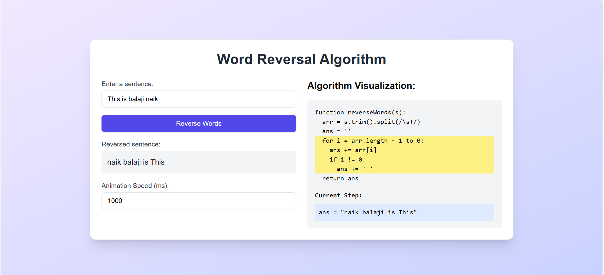
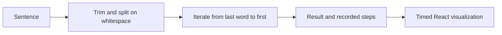

# Word Reversal Visualizer

**Watch a sentence become a reversed sequence of words, one step at a time.**

An interactive Next.js learning tool that displays the result, intermediate state, and highlighted pseudocode beside the input.



## Why this project

A short string algorithm can hide several useful ideas: trimming whitespace, splitting input, iterating backward, and building a result. This visualization makes those steps visible for learners practicing basic algorithms and React state.

## Features

- Enter a sentence and reverse its word order.
- See the split array and each intermediate result.
- Follow pseudocode highlighting during the animation.
- Adjust the delay between animation steps in milliseconds.

## Run locally

Download and extract the repository, then run from the root with Node.js and npm:

```bash
npm install
npm run dev
```

Open `http://localhost:3000`.

```bash
npm run build
npm start
```

## Example

Input: `  learn   by building  `

Output: `building by learn`

The algorithm trims leading/trailing whitespace and splits on consecutive whitespace. It reverses the order of words; characters within each word keep their original order.

## How it works



The implementation lives in [app/page.tsx](app/page.tsx). The calculation produces the full result and an array of explanatory steps, then a timer advances the displayed step.

## Source guide

| Path | Purpose |
| --- | --- |
| [app/page.tsx](app/page.tsx) | Algorithm and interactive page |
| [components/ui](components/ui) | Button, input, and card components |
| [app/globals.css](app/globals.css) | Global styling |
| [package.json](package.json) | Next.js scripts and dependencies |

This is an educational, browser-side visualization. It does not require a database or model API. When extending it, keep the displayed pseudocode and actual algorithm synchronized.
